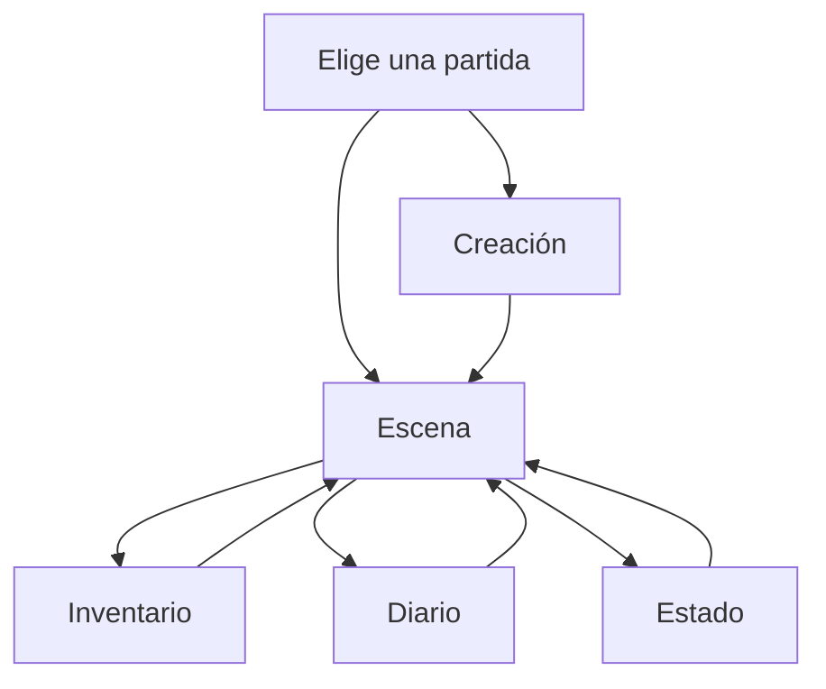

# Milestone 10 design — revised

Status: approved and completed on 11 November 2026. Completion is recorded in [ROADMAP.md](ROADMAP.md). The six pictures remain provisional. Reduced motion is only partly verified: the stored numbers were checked, and the first still frame was not captured. That capture is milestone 11. A restored game does not scroll the column. Alignment happens only after the player completes an action that publishes a new narration.

Depends on milestone 9, which is completed. The numbers, the effect order, the saves, and the narrator contracts stay as they are in [GAME_RULES.md](GAME_RULES.md) and [ARCHITECTURE.md](ARCHITECTURE.md). This design changes presentation. It does not change a rule.

## What the review already approved

- One activity. No Navigation library and no new dependency.
- The Kotlin engines remain the only writers of rules state. Room stays at version 4. The backend contract stays as it is.
- Inventory, the journal, and the character sheet read the confirmed state.
- A finished game stays saved. This milestone adds no control that erases a save.
- Portrait follows the platform rules already written in [ARCHITECTURE.md](ARCHITECTURE.md).
- General controls move to Spanish. Internal ids stay internal. The Guardian's Bridge keeps its intents, its narrator contract, its save, and its authored scene sentences.

## What this revision changes

- The scene has a fixed header and one scrolling column. The picture, the narration, the stored roll, and every decision share that column. The free-text field stays fixed on one compact row, with the send button beside it.
- Each of the six Valdumbría places has a static local picture. The screen does not use the sentence "Ilustración pendiente" as the picture.
- A short d20 animation plays only after the stored `CheckResult` exists. It can be skipped, and it respects reduced motion.
- The journal separates clues, evidence, and discovered places. The inventory shows the six-item limit and stays read-only.
- The five endings have distinct presentations. Midnight, a life change, and Inés's known state are called out from the confirmed state.

## Objective

The player reads Las campanas de Valdumbría as a dark-fantasy gamebook on a phone held upright. The picture and the narration occupy the center. Decisions and free text stay within reach. The clock, life, a stored roll, inventory, the journal, and the ending are readable. The screen is not a debug dump.

`GuardiansBridgeEngine` remains the only writer of bridge health, inventory, and outcome. `AdventureEngine` remains the only writer of adventure state. `AdventureSession` remains the only player path into a deduction. The two saves do not replace each other.

## What this milestone does not do

- It does not start milestone 11. Tone, unrevealed canon, the whole-summary discard, provider JSON errors, and reply latency stay there.
- It does not add a rule, an action, an item, an ending, a class, or a difficulty.
- It does not migrate Room, change `AdventureState`, or change either narrator contract.
- It does not let the screen roll a die, grant a clue, change life, or set an ending.
- It does not rewrite Valdumbría `localProse`, clue text, or evidence text.
- It does not translate the bridge's fixed scene sentences.
- It does not add a landscape layout, a settings screen, an interactive map, or a request that generates a picture during play.
- It does not add a way to delete the current game.

## 1. Navigation

`MainActivity` still opens on `GamePicker`. The picker remembers which game is open. "Elegir otra partida" returns to the picker and leaves both saves where they are.

There is no Navigation Compose library and no second activity. Valdumbría keeps one composable and a saveable page value:

| page | how it opens | what it writes |
| --- | --- | --- |
| Scene | the game opens here, and back returns here | the existing session calls, from the scene only |
| Inventory | Inventario in the header | nothing |
| Journal | Diario in the header | nothing |
| Character | Estado in the header | nothing |

Back, or the system back action, returns to the scene. Opening a page does not restore from Room again and does not start a turn. The pages share the scene's `StateFlow`, so a turn that finishes while a page is open updates that page. A configuration change keeps the open page. Process death restores the game from Room and returns to the scene.

The ending is the same scene. The decision buttons and the free-text row hide, and the ending plate sits in the column after the narration. It is not a new route. Inventory and the journal remain reachable from the header. Leaving for those pages and returning restores the column's scroll position.

The bridge does not gain these pages. Its log stays on the bridge scene. Its buttons still send Persuade, Pay, and Attack.



A save skips creation and opens the scene. Creation runs only when that game has no save.

## 2. Main screen

The Valdumbría scene is one vertical column. The header stays put. One column scrolls. The free-text row stays put under that column. Decisions are ordinary buttons in the scrolling column. They do not have a scroll of their own.

```text
┌──────────────────────────────┐
│ Plaza          22:05   10/10 │  header, fixed
│ Inventario  Diario   Estado  │
├──────────────────────────────┤
│   [picture of the plaza]     │
│   narration                  │
│   Inés and life, when known  │  one scroll
│   stored check, when present │
│   Leer la carta de Elia      │
│   Hablar con Inés            │
│   …                          │
├──────────────────────────────┤
│ O escribe una acción  Enviar │  one row, fixed
└──────────────────────────────┘
```

The header is two compact rows. The first row is the location name, "Hora" with the clock from `clockLabel`, and "Vida n/10" with ten marks filled to the stored health. The second row is Inventario, Diario, and Estado. At a large font the rows wrap. They do not overflow off the screen.

The scrolling column holds, in this order:

- The picture for the current location, full width, at most 180dp tall.
- The narration already committed for this turn. On a fresh arrival in this process, it may type on. A tap shows the rest. A restored line is shown complete.
- The Inés plate, when `inesClockLine` returns one, and the life-change line, when this process has just observed a new health value. The notice sits with them. These lines are part of the reading, before the roll.
- The check strip, when the latest confirmed resolution has a `CheckResult`.
- Every available decision, one compact button after another. Each button shows `choiceLabel` and sends the action id.

A decision button is at least 48dp tall, with about 8dp of space before the next one. The label uses one line when it fits, and the button grows if the words wrap. The buttons are narrower in padding than a tall block, and they remain easy to tap. There is no inner list and no second scrollbar.

The free-text row is one compact row under the column. The field shows "O escribe una acción" and starts at a single line. As the player types, it grows up to four lines and then scrolls inside the field. "Enviar" sits beside the field, at least 48dp tall, and is enabled when the field is not blank. TalkBack announces the existing limit of 500 characters. The row does not add a second line for that count. The field clears after a submit.

When the keyboard opens, the row lifts with the inset and stays above the keys. The scrolling column shortens by the same inset. The field and "Enviar" remain visible. The keyboard does not cover them, and the field does not move into the scrolling column.

Scroll position:

- The first time a new narration is published during this visit to the scene, the column aligns the top of that narration with the top of the viewport, once. The picture stays above it and is reached by scrolling up. The player then reads downward to the roll and the decisions.
- Type-on, a notice, the settling of the die, and a button becoming enabled do not move the offset.
- After that first alignment, the player's own scroll is left where they put it.
- Opening Inventario, Diario, or Estado remembers the offset. Returning restores it. Those pages do not send the column back to the top.
- Restoring a game does not move the column. Opening Inventario, Diario, or Estado remembers the offset. Returning restores it.

While a turn is in flight, the decision buttons and "Enviar" are disabled, and the column shows "La partida está resolviendo la acción." under the narration. When narration is pending, the column shows "La narración está pendiente." and the button "Reintentar la narración" in that same flow. When the scene is paused, it shows the existing waiting notice in Spanish and does not invent a new recovery. When an ending is stored, the decision buttons and the free-text row hide.

The bridge uses the same column, without the clock, the journal, the pictures, or Estado. Its header shows the character, life, and the three attributes. Its scrolling column shows the latest scene sentence, the log, and then Convencer, Pagar, and Atacar. Its free-text row is the same one-line field with "Enviar" beside it, while the outcome is ongoing.

## 3. Pictures

The build contains six static pictures, one for each location. They are bundled in the app. Play does not generate an image and does not ask the backend for one.

| location id | resource | what the player may see |
| --- | --- | --- |
| `plaza` | `valdumbria_plaza` | The square at night, wet stone, the bell tower as a silhouette. |
| `tavern` | `valdumbria_tavern` | The tavern doorway and a dark room, firelight, no creature. |
| `church` | `valdumbria_church` | The parish church, candles, a closed side door. |
| `cemetery` | `valdumbria_cemetery` | Graves, fog, uneven ground. |
| `archive` | `valdumbria_archive` | Shelves, a lamp, closed books. |
| `crypt` | `valdumbria_crypt` | Stone stairs and sealed niches. |

The pictures share one grade: near-black, moonlight, one brass light, fog, and rural stone. They are cinematic stills. They contain no baked words, no modern objects, and no portrait that identifies a culprit. They do not show Elia's death, a monster treated as real, Inés's fate, a hidden list, an altered register that can be read, or an opened proof.

The files live in `app/src/main/res/drawable-nodpi/` as WebP, long edge about 1200 pixels. A presentation registry maps the location id to the resource. The screen asks for the picture of the current location only. TalkBack names the place, "Plaza" and the others, using the document's name.

The first six files shipped with this milestone are provisional. The registry and this document say so. The screen does not. There is no overlay reading "Ilustración pendiente" and no claim on screen that the picture is the final art. Replacing a file later keeps the same resource name. An unknown location id shows the night frame already used for the palette, with the location's Spanish name if the document has one, and never the raw id.

No image library is added. Compose loads the resource.

## 4. Rolls

The action tap calls `choose` or `submitText`. The engine rolls inside the commit that already resolves the action. The screen reads the stored `CheckResult` after that commit has returned. It does not call `Die`, `Random`, or `resolveCheck`.

The animation is a brief settling of a d20 whose last face is the stored `roll`. Beside it the strip shows:

- Dado: the stored roll.
- Atributo: Fuerza, Agilidad, or Inteligencia, from the attribute the resolution already recorded.
- Modificador: the stored modifier.
- Total: the stored total.
- Dificultad: the stored difficulty, one of 8, 12, 16, or 20.
- Resultado: "Supera la prueba" or "No supera la prueba".

"Omitir" and a tap on the die end the animation on those final numbers. An animator scale of zero shows the final numbers at once. The animation is not saved. Process death during it restores the committed result and does not roll again. An action with no check leaves the strip hidden.

A missing action label shows "Acción" and does not print the id. The button still sends the id.

## 5. Journal, inventory, and status

Inventory lists every carried item by its Spanish presentation name. `coin_purse` is shown as "Bolsa de monedas". `Character.COIN_PURSE_NAME` stays "Coin Purse". "Ganzúa de Tomás" and "Lino de Mara" stay as stored. The page says "Llevas n de 6", from `inventory.size` and `Character.MAX_INVENTORY`. It has no use button and no drop button. An item appears or disappears only after an action the engine has accepted. The list never shows an item id.

The journal is one page with separate sections. A section lists only facts already on the confirmed state, in document order, using natural Spanish:

- Pistas. Clue text for ids in `clueIds`. Empty: "Todavía no tienes pistas."
- Pruebas. Evidence text for ids in `evidenceIds`. Empty: "Todavía no tienes pruebas."
- Lugares. Location names for ids in `discoveredLocationIds`. Empty: "Todavía no has descubierto otros lugares."
- Reciente. Narration lines already shown in this save. This is player-visible history, not `narrativeSummary`. Empty: "Todavía no hay líneas que recordar."

The journal does not show flags, attempts, claim ids, action ids, evidence ids, undiscovered clues, undiscovered evidence, or undiscovered places. A line the player has already seen, including "Elia está muerta" after the action that stated it, may appear again under Reciente. That is a repetition. Whether model prose reveals a secret too early remains milestone 11.

Estado shows the character name, the Spanish class name, Fuerza, Agilidad, Inteligencia, life, the clock, and the location. The attributes stay the class values: Guerrero 4, 3, and 2; Explorador 2, 4, and 3; Erudito 2, 2, and 5. Nothing on this page edits them.

## 6. Endings and consequences

The five ending titles stay the ones already shipped. The plate is visual. It does not add a new sentence and it does not change the ending the engine stored.

| ending id | title, unchanged | plate |
| --- | --- | --- |
| `justice` | Final: la verdad queda publicada | Brass rule, parchment title, the last narration, life and clock as stored. |
| `vengeance` | Final: la venganza cae sobre el culpable | Near-black plate, the title set large, brass reduced to a thin line. |
| `silence` | Final: el secreto permanece | Muted sage plate, the title set smaller, the narration kept. |
| `failure` | Final: Valdumbría queda atrás | A quiet dusk band above the title. The band is not a seventh location picture and names no new place. |
| `death` | Final: la caída acaba contigo | The ten life marks are empty, the picture is dimmed, the title remains. |

Choices and the text field hide. Inventory and the journal still open. "Elegir otra partida" returns to the picker. The save remains, so the next opening shows the same plate and does not roll.

Three consequences use facts the engine has already stored. They do not write those facts.

- Midnight. When this process sees a new `MidnightFired` entry in the committed history, the header shows "Medianoche" next to the clock for that reveal. A later visit, and a restore of a game already past midnight, shows the clock without repeating the word.
- Life. When the health just committed differs from the health last shown in this process, the center shows "Vida {antes} → {ahora}" once. The two numbers are the previous and the new stored health. A restore does not replay the arrow.
- Inés. The plate uses `inesClockLine` and nothing else. Before midnight it is the warning sentence, set as secondary text. After midnight, the saved sentence and the lost sentences sit in a stronger plate. The wording in the copy table keeps a protection that finishes with the bells distinct from a rescue.

The bridge headlines "Has cruzado el puente" and "Has sido derrotado" stay chrome around the engine's English line.

## 7. Language

Navigation and general controls are Spanish. The copy table is the list. Approving this revision approves that wording.

Internal ids are not shown. Action buttons, ending plates, inventory, the journal, and TalkBack names use the Spanish labels. The ids still travel on the existing calls.

The Guardian's Bridge stays compatible. Persuade, Pay, and Attack remain the intents. The narrator payload stays the two-field contract. The bridge save stays separate. The fixed scene sentences stay English. The buttons around them are Convencer, Pagar, and Atacar.

"Esa conclusión no se sostiene." stays as it is. The forty-six action labels and the five ending titles stay as they are.

### Copy

| where | Spanish |
| --- | --- |
| Picker | "Elige una partida. Cada una guarda la suya." |
| Picker | "El puente del guardián" |
| Picker | "Elegir otra partida" |
| Creation | "Crea un personaje. La clase fija la Fuerza, la Agilidad y la Inteligencia." |
| Creation | "Nombre" |
| Creation | "Guerrero", "Explorador", "Erudito" |
| Creation | "Comenzar" |
| Creation | "El personaje no puede empezar." |
| Header | "Hora", "Vida", "Medianoche" |
| Header | "Inventario", "Diario", "Estado" |
| Scene | "Según las reglas" |
| Scene | "O escribe una acción", "Enviar" |
| Scene | "Reintentar la narración" |
| Scene | "La partida está resolviendo la acción." |
| Scene | "La narración está pendiente." |
| Inés, warned, bells not yet rung | "Inés está avisada. Las campanas no han sonado, así que su destino no está decidido." |
| Inés, saved | "Medianoche: Inés está a salvo." |
| Inés, lost because the protection finished with the bells | "Medianoche: Inés está perdida. Una protección que acabó al sonar las campanas no la salvó." |
| Inés, lost | "Medianoche: Inés está perdida." |
| Inés, midnight without a recorded fate | "Ha sonado la medianoche. El destino de Inés no consta." |
| Notices | "La acción debe tener entre 1 y 500 caracteres." |
| Notices | "No se ha hecho ninguna acción." |
| Notices | "Esa acción no está disponible." |
| Notices | "La escena sigue en espera." |
| Notices | "La escena está en espera." |
| Notices | "La escena no se ha guardado." |
| Notices | "No se ha podido leer la aventura confirmada." |
| Notices | "No se ha podido leer la aventura guardada." |
| Notices | "El guardado ha fallado. Se mantiene el estado anterior." |
| Notices | "Otra acción se ha guardado antes." |
| Notices | "La acción ha sido rechazada." |
| Notices | "La narración no coincide con el estado guardado." |
| Notices | "El resultado está guardado. La narración se puede reintentar." |
| Notices | "La narración no se ha guardado." |
| Roll | "Dado", "Atributo", "Modificador", "Total", "Dificultad" |
| Roll | "Supera la prueba", "No supera la prueba", "Omitir" |
| Inventory | "Bolsa de monedas", "Llevas n de 6" |
| Journal | "Pistas", "Pruebas", "Lugares", "Reciente" |
| Journal | "Todavía no tienes pistas." |
| Journal | "Todavía no tienes pruebas." |
| Journal | "Todavía no has descubierto otros lugares." |
| Journal | "Todavía no hay líneas que recordar." |
| Life change | "Vida {antes} → {ahora}" |
| Bridge buttons | "Convencer", "Pagar", "Atacar" |
| Bridge field | "Acción libre", "Enviar acción" |
| Bridge log | "Registro" |
| Bridge headlines | "Has cruzado el puente", "Has sido derrotado" |
| Bridge rejection | "La escena ya ha terminado." |
| Bridge rejection | "El guardián no entiende esa acción." |
| Bridge rejection | "Esa acción intenta hacer más de una cosa." |
| Bridge rejection | "No llevas nada que el guardián acepte." |
| Bridge log | "Pierdes {nombre}." |

Creation still calls `Character.create`. "Comenzar" stays disabled until the trimmed name is not blank. A name the constructor rejects shows "El personaje no puede empezar." The class card reads, for example, "Erudito. Fuerza 2, Agilidad 2, Inteligencia 5."

## 8. Portrait and accessibility

Every layout in this design is a vertical column. There is no `layout-land` resource and no second composition for a wide screen.

The implementation sets `android:screenOrientation="portrait"` on the one activity. It does not set `android:appCategory="game"`. It does not set `android.window.PROPERTY_COMPAT_ALLOW_RESTRICTED_RESIZABILITY`. Those choices match the platform note already in [ARCHITECTURE.md](ARCHITECTURE.md).

On a display whose smallest width is below 600dp, the activity stays portrait when the device rotates. The check is a phone emulator.

On a display of at least 600dp, Android ignores that lock for an app that targets API 37. The portrait column is still the only layout. The implementation records what that display actually does: whether the column letterboxes, stretches, or rotates. That observation is written into [ARCHITECTURE.md](ARCHITECTURE.md) when the milestone is implemented. If no large display is available, the report says the large-display check was not verified. The phone lock can still pass.

Accessibility:

- TalkBack order follows the column: location, clock, life, the three consult controls, the picture by its place name, narration, the Inés plate, the check, each choice, then the text field and Enviar.
- Life is announced as "Vida n de 10".
- Success, failure, midnight, and the life change are words, not only color or motion.
- Text at a large font scale wraps. The column scrolls. Enviar stays on screen. Decision targets stay at least 48dp, with a clear gap between them.
- Parchment `#F3E6D0` on `#14110E`, and dark text `#2A1C08` on brass `#D4A656`, are the contrast pairs. Sage `#8C9A86` is secondary text on the same background, used at a size that stays readable.
- An animator scale of zero skips the type-on and the d20 settle.

Performance:

- Interpretation, resolution, and narration stay off the main thread.
- The type-on and the die animate values already in memory.
- Opening inventory or Estado does not read Room and does not decode a picture. Opening the journal does not read Room. It decodes the still of each discovered place.
- The scene decodes the current location's picture. The journal decodes the stills of the places already discovered.

## 9. Acceptance and tests

Acceptance:

- The header stays fixed. The picture, the narration, the stored roll, and every decision share one scroll. There is no second list for the actions. The free-text row stays fixed, starts at one line, grows while typing, and keeps Enviar beside the field and above the keyboard.
- The six pictures are local and static. The plaza picture is visible on a new game. The screen does not show "Ilustración pendiente".
- A confirmed check shows die, attribute, modifier, total, difficulty, and success or failure. Skip and reduced motion show that same stored result. The UI does not roll.
- The journal's three discovery sections are separate and list only discovered Spanish text. Inventory shows "Llevas n de 6" and cannot change the bag.
- Each of the five endings uses its own plate and its existing title. Midnight, a life change, and a known Inés line are visible when the confirmed state has them, and they are not replayed on restore.
- Navigation and general controls in the copy table are Spanish. The bridge still sends Persuade, Pay, and Attack.
- A phone whose smallest width is below 600dp stays portrait. The large-display result is written down, or marked not verified.
- No health, inventory, clock, clue, evidence, or ending value originates in the UI. A milestone 9 save restores to the same scene, clock, life, inventory, and ending.
- `domain` still imports neither Android nor Compose.

Tests, with no new test library:

- JVM tests cover the Spanish chrome, the action labels, the ending titles, the Inés sentences, and the coin-purse presentation name.
- A pure function formats a known `CheckResult` with roll, modifier, total, difficulty, and the success word. Skip and the reduced-motion path return that same result. The test does not construct `RandomDie`.
- The picture registry maps the six location ids to the six resource names. The TalkBack name is the location name and contains no underscore.
- The journal mapping builds three separate lists and includes only ids present on the state. It does not read `narrativeSummary`.
- Ending presentation is a total map from the five ending ids to the five plates, and the titles stay the milestone 9 strings.
- Midnight and the life arrow are functions of the previous shown snapshot and the new committed snapshot. A restore flag suppresses both.
- A missing label does not contain an underscore or an action id.
- `./gradlew :app:testDebugUnitTest` and `./gradlew :app:assembleDebug` run, because the manifest, the screens, and the pictures change.
- `android-qa` installs the debug build on a phone emulator, confirms portrait after rotation, confirms the opening picture is an image, and confirms the decisions sit in the same scroll as the narration. It opens inventory and returns to the same scroll position. It opens the keyboard and confirms the field and Enviar stay above the keys. It creates a character with the Spanish class names, opens the journal, and confirms those pages did not add a clue or change life. It does not replay the five endings.
- The bridge totals and the bridge damage stay in place.

Risks:

- The provisional pictures can be mistaken for finished art in a build review. The milestone report names them as provisional. The screen does not.
- A picture can leak a secret by showing a body, a monster, or a readable proof. The art direction above is the check, and the review of the six files is part of acceptance.
- Showing the difficulty tells the player the number of that check. It does not reveal the culprit.
- Reciente can repeat a fact the player has already seen. Model prose that reveals a secret too early is still milestone 11.
- The portrait lock does not hold on a large display at API 37. The design records that result.
- A consult page that called `choose` or `submitText` would become a second writer. These pages have no action control.
- Translating the Inés line can drift from the rule. The sentences in the copy table are the wording that keeps the bells distinct from a rescue.

## Files the implementation is expected to touch

These files are listed so the review can see the boundary. This document does not edit them.

- `app/src/main/java/com/dungeonmasterai/presentation/ValdumbriaScreen.kt`
- `app/src/main/java/com/dungeonmasterai/presentation/ValdumbriaViewModel.kt`
- `app/src/main/java/com/dungeonmasterai/presentation/ValdumbriaStatus.kt`
- `app/src/main/java/com/dungeonmasterai/presentation/GameScreen.kt`
- `app/src/main/java/com/dungeonmasterai/presentation/GamePicker.kt`
- `app/src/main/java/com/dungeonmasterai/presentation/theme/Theme.kt`
- `app/src/main/java/com/dungeonmasterai/presentation/AdventureSession.kt`, for the Spanish notices only
- `app/src/main/res/drawable-nodpi/valdumbria_plaza.webp` and the five sibling pictures
- `app/src/main/AndroidManifest.xml`
- the JVM tests that lock the copy, the check line, the picture registry, the journal mapping, and the ending plates
- [ARCHITECTURE.md](ARCHITECTURE.md), to record the phone check and the large-display observation

The implementation is expected to leave these alone: `domain` engines and models, `valdumbria.json`, Room, the backend, and the bridge narrator parser.
